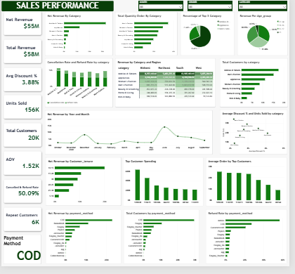

# E-Commerce Sales Analysis: Excel and Power BI
 
End-to-end analysis of e-commerce order data: cleaning and validation in **Excel**, modelling and dashboarding in **Power BI**.
 

 
## Business Problem
 
The business wants to understand three things:
 
1. **Top-selling products:** which categories generate the most revenue, and where do they lose it?
2. **Sales trends over time:** when does revenue peak, and what drives those peaks?
3. **Customer behaviour:** who buys, how often, how they pay, and how discounts affect orders.
## Dataset
 
| Item | Detail |
|---|---|
| Source | `[add source and link, and check its licence]` |
| Period | October 2020 to September 2021 |
| Raw data | 286,392 rows, 36 columns `[verify against your raw sheet]` |
| After Excel cleaning | 204,127 rows |
| After Power BI cleaning | 193,794 rows, 7 product categories |
| Key fields | order_id, cust_id, category, qty_ordered, price, discount, status, payment_method, region, age group, gender, customer tenure |
 
> **Privacy:** the raw data contained personal information (SSNs, emails, phone numbers). These columns are **not** included in this repository. Only the cleaned, anonymised dataset is shared.
 
## Tools
 
- **Excel:** data cleaning, standardisation, validation checks
- **Power BI:** Power Query transformations, data model, DAX measures, interactive dashboard
## Data Cleaning and Validation
 
### In Excel
- Removed blanks and standardised inconsistent text (status and payment method values, such as lowercase vs title case)
- Fixed data types for dates, numbers, and IDs
- Checked that `qty_ordered × price = Total_revenue` (all rows reconciled)
- Investigated `Net_revenue` mismatches (`Total_revenue − Discount amount ≠ Net_revenue`) in 3,519 rows
- Flagged the `month` column, which had been converted incorrectly to 2026 dates; rebuilt the month fields from `order_date`
### In Power BI (Power Query)
1. Detected and removed duplicate order records
2. Removed the categories Books and School & Education (too few rows to analyse reliably)
3. Added a conditional column for status grouping
4. Replaced inconsistent values and corrected data types
5. Final row count: **193,794**
### Definition of valid revenue
Revenue KPIs use the dataset's own flag `bi_st = "Valid"`.
 
- `Valid` includes statuses Received, Cod, Paid, Order_Refunded, and Refund.
- `Net` (Complete and Closed) and `Gross` (including Canceled) are excluded from the Net Revenue KPI.
- **Note:** `Valid` includes refunded orders (about $26.7M of the $54.55M). The cancellation and refund rates are therefore reported separately.
## Dashboard
 
### KPIs
 
| KPI | Value |
|---|---|
| Net Revenue (valid) | $54.55M |
| Total Revenue | $57.67M |
| Avg Discount | 3.88% |
| Units Sold | 156K |
| Total Customers | 19.8K |
| Average Order Value | 1.52K |
| Cancelled and Refunded Rate | about 48.7% (37.1% cancelled, 11.6% refunded) |
| Repeat Customers | 6,102 (30.9%) |
 
### Pages and visuals
- Net revenue, quantity, and cancellation and refund rates by category
- Category by region matrix
- Monthly net revenue trend
- Revenue by customer tenure, age group, and top customers (anonymised)
- Net revenue, customers, and refund rate by payment method
- Slicers: Month, Gender, Category
`[add more screenshots in /images]`
 
## Key DAX Measures (examples)
 
```DAX
Valid Net Revenue =
CALCULATE(
    SUM(Cleaned_data[Net_revenue]),
    Cleaned_data[bi_st] = "Valid"
)
 
Total Orders = DISTINCTCOUNT(Cleaned_data[order_id])
 
AOV = DIVIDE([Valid Net Revenue], CALCULATE([Total Orders], Cleaned_data[bi_st] = "Valid"))
 
Cancellation Rate =
DIVIDE(
    CALCULATE([Total Orders], Cleaned_data[status] = "Canceled"),
    [Total Orders]
)
 
Repeat Customer Rate =
DIVIDE(
    COUNTROWS(
        FILTER(
            VALUES(Cleaned_data[cust_id]),
            CALCULATE(DISTINCTCOUNT(Cleaned_data[order_id])) > 1
        )
    ),
    DISTINCTCOUNT(Cleaned_data[cust_id])
)
```
 
## Key Insights and Recommendations
 
| # | Insight | Evidence | Recommendation |
|---|---|---|---|
| 1 | Revenue is concentrated in two categories | Mobiles & Tablets 59.8% and Appliances 22.2% of valid revenue; top 3 = 88.9% | Protect stock and supplier terms for these two; treat other categories as growth tests |
| 2 | Fashion drives units, not revenue | Men's Fashion sold the most units (34.4K) but earns 5.3% of revenue | Use fashion as a traffic driver; bundle with electronics |
| 3 | Highest-value categories cancel most | Mobiles & Tablets 49.1% and Appliances 41.0% cancelled, vs 27–29% for fashion and beauty | Audit stock accuracy and delivery times for electronics |
| 4 | Payment method drives cancellations | Bankalfalah 74.1%, Easypay 60.7%, COD 8.1% cancelled; COD has a 22.6% refund rate | Investigate checkout failures on digital methods; review COD refunds |
| 5 | Sales peaked in June | June $14.0M (25.7% of valid revenue); December $8.2M | Plan inventory around peaks; run promotions in slow months |
| 6 | Cancellations rise through the year | 28.5% in October to 52.8% in August | Investigate what changed from mid-2021; track monthly |
| 7 | Discounts raise quantity, not value | 25%+ discounts average 5.6 units per line but lower value per line; 0–10% discounts show the highest cancellation rate (51.4%) | Reserve deep discounts for bulk or clearance |
| 8 | South leads; region doesn't drive cancellations | South 38.1% of revenue; cancellation 36.5–37.9% in all regions | Study why Northeast and West lag |
| 9 | Low repeat rate, concentrated spend | 30.9% repeat customers; top 10% of customers = 70.0% of revenue | Second-purchase offers; VIP programme for top customers |
| 10 | Age and gender are balanced | Each main age band contributes 31–33%; Female 51.3% / Male 48.7% | Broad marketing is sufficient |
 
## Limitations
- One year of data, so seasonality and trends are tentative.
- No cost data, so this is revenue analysis, not profit.
- The `Valid` definition includes refunded orders; see the note above.
- Two categories were removed, so totals don't cover the full business.
## Repository Structure
 
```
├── data/        cleaned, anonymised dataset + data dictionary
├── excel/       workbook with cleaning and validation log
├── powerbi/     .pbix file (no personal data)
├── images/      dashboard screenshots
├── docs/        insights and recommendations (PDF)
└── README.md
```
 
## What I Learned
- Defining "valid revenue" changes every KPI, so the definition must be explicit.
- Duplicate detection and reconciliation checks matter before any visualisation.
- A dashboard is more useful when each visual ends in a recommendation.
## Contact
 
**[Your Name]**
LinkedIn: `[link]` | Portfolio: `[link]` | Email: `[email]`
 
