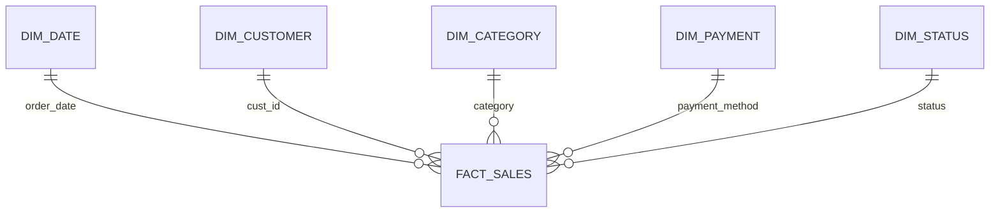

# E-Commerce Sales Performance Analysis: Excel and Power BI
 
End-to-end business intelligence case study: data cleaning and validation in **Excel**, data modelling and dashboarding in **Power BI**.
 

 
---
 
## 1. Project Overview and Scope
 
An online retailer wants to understand which categories earn the most, how sales move over time, and how customers behave, so that management can decide where to invest, what to fix, and how to keep customers.
 
| Item | Detail |
|---|---|
| Period | October 2020 to September 2021 |
| Source | `[add dataset source and link; confirm its licence]` |
| Purpose | Portfolio and educational project |
| Raw data | 286,392 rows, 36 columns `[verify against your raw sheet]` |
| After Excel cleaning | 204,127 rows |
| After Power BI cleaning | 193,794 rows across 7 categories |
| Tools | Excel, Power Query, Power BI (DAX) |
 
**Scope and assumptions**
- Two categories (Books, School & Education) were removed because they had too few rows to analyse reliably, so totals do not cover the full business.
- "Valid revenue" uses the dataset's own flag `bi_st = "Valid"` (see Section 5).
- There is no cost data, so this is a revenue analysis, not a profit analysis.
- The data covers one year, so year-over-year comparison is not possible and seasonality findings are tentative.
> **Privacy:** the raw data contained personal information (SSNs, emails, phone numbers). Those columns are **not** included in this repository. Only the cleaned, anonymised dataset is shared.
 
---
 
## 2. Business Objectives
 
Management wants to understand:
 
1. Which product categories generate the most revenue and units
2. How much revenue is lost to cancellations and refunds, and where
3. How revenue, orders, and average order value change month by month
4. Which months and categories drive peak sales
5. Which regions perform best
6. Who the customers are (age, gender, tenure) and how they differ
7. How often customers return and how concentrated spending is
8. How payment methods and discounts affect order outcomes
---
 
## 3. Dataset Structure
 
| Domain | Fields |
|---|---|
| Orders | order_id, order_date, status, bi_st |
| Product | category, qty_ordered, price |
| Financial | Total_revenue, Discount_Percent, Dis_Amounted, Net_revenue |
| Customer | cust_id, User Name (anonymised), Gender, age, Age_group, Customer_Total_Years |
| Geography | County, Region |
| Payment | payment_method |
| Time | year, month, Month Name, Month_number |
 
Grain of the data: **one row per order line** (an order can contain items from several categories).
 
---
 
## 4. Analytical Questions
 
**Top-selling categories**
1. Which categories generate the most net revenue, and do they rank the same by units sold?
2. What share of revenue comes from the top 3 categories?
3. Which categories have the highest cancellation and refund rates?
4. Which categories are discounted most?
   
**Sales trends**

6. How do net revenue, orders, and AOV change month by month?
7. Which months peak, and which categories drive them?
8. Do regions peak at different times?
9. Is the cancellation rate stable across the year?
 
**Customer behaviour**

9. How do age group, gender, and region compare on revenue and AOV?
10. Do longer-tenured customers spend more?
11. What share of customers buy more than once?
12. How concentrated is revenue among top customers?
13. Which payment methods are most used, and which cancel most?
14. Do higher discounts raise order value or reduce cancellations?
 
---
 
## 5. The Process
 
### 5.1 Data cleaning and validation (Excel)
 
| Check | Finding | Action |
|---|---|---|
| Duplicates | 8,516 fully identical rows | Removed in Power Query (Removed Duplicates step) |
| Inconsistent text | Mixed-case status and payment_method values | Standardised to consistent labels |
| Revenue reconciliation | `qty_ordered × price = Total_revenue` in every row | No action needed |
| Net revenue reconciliation | 3,519 rows where `Total_revenue − Dis_Amounted ≠ Net_revenue` | `[state how you resolved this]` |
| Broken date field | `month` column converted to 2026 dates in every row | Replaced by a proper Date table and `Month Name` / `Month_number` |
| Unsuitable categories | Books and School & Education had very few rows | Filtered out (about 1,800 rows) |
| Personal data | SSN, email, and phone columns in the raw sheet | Excluded from the shared dataset |
 
Row count: 204,127 (Excel-cleaned) to 193,794 (final).
 
### 5.2 Power Query steps
Source, Navigation, Promoted Headers, Changed Type, Removed Duplicates, Filtered Rows, Added Conditional Column, Replaced Value (x2), Changed Type.
 
### 5.3 Definition of valid revenue
Revenue KPIs use `bi_st = "Valid"`.
- `Valid` includes statuses such as Received, Cod, Paid, Order_Refunded, and Refund.
- `Net` (Complete and Closed) and `Gross` are not counted in the Net Revenue KPI.
- **Note:** `Valid` includes refunded orders (about $26.7M of the $54.55M), so cancellation and refund rates are reported separately.
### 5.4 Data model (star schema)
 

 
| Table | Type | Key columns |
|---|---|---|
| Fact_Sales | Fact | order_id, order_date, cust_id, category, payment_method, status, qty_ordered, price, Total_revenue, Discount_Percent, Dis_Amounted, Net_revenue |
| Dim_Date | Dimension | Date, Year, Quarter, Month Number, Month Name, Month Year, Sort Key |
| Dim_Customer | Dimension | cust_id, User Name (anonymised), Gender, age, Age_group, Customer_Total_Years, County, Region |
| Dim_Category | Dimension | category |
| Dim_Payment | Dimension | payment_method |
| Dim_Status | Dimension | status, bi_st |
 
Relationships are one-to-many, single direction, from each dimension to `Fact_Sales`.
 
### 5.5 Date table (DAX)
 
```DAX
Dim_Date =
ADDCOLUMNS(
    CALENDAR(DATE(2020,10,1), DATE(2021,9,30)),
    "Year", YEAR([Date]),
    "Quarter", "Q" & ROUNDUP(MONTH([Date]) / 3, 0),
    "Month Number", MONTH([Date]),
    "Month Name", FORMAT([Date], "MMM"),
    "Month Year", FORMAT([Date], "MMM YYYY"),
    "Sort Key", YEAR([Date]) * 100 + MONTH([Date])
)
```
`Month Year` is sorted by `Sort Key` so months appear in time order.
 
### 5.6 Key DAX measures
 
| Measure | Purpose |
|---|---|
| Valid Net Revenue | Net revenue where `bi_st = "Valid"` |
| Valid Gross Revenue | Total revenue before discounts, valid only |
| Units Sold | Units on valid lines |
| Total Orders | Distinct orders |
| AOV | Valid net revenue ÷ valid orders |
| Cancellation Rate | Share of lines with status Canceled |
| Refund Rate | Share of lines with status Order_Refunded or Refund |
| Total Customers | Distinct valid customers |
| Repeat Customer Rate | Customers with 2+ orders ÷ customers |
| MoM Growth % | Change in valid revenue vs previous month |
 
```DAX
Valid Net Revenue =
CALCULATE(SUM(Fact_Sales[Net_revenue]), Fact_Sales[bi_st] = "Valid")
 
Valid Orders =
CALCULATE(DISTINCTCOUNT(Fact_Sales[order_id]), Fact_Sales[bi_st] = "Valid")
 
AOV = DIVIDE([Valid Net Revenue], [Valid Orders])
 
Cancellation Rate =
DIVIDE(
    CALCULATE(COUNTROWS(Fact_Sales), Fact_Sales[status] = "Canceled"),
    COUNTROWS(Fact_Sales)
)
 
Refund Rate =
DIVIDE(
    CALCULATE(COUNTROWS(Fact_Sales), Fact_Sales[status] IN {"Order_Refunded", "Refund"}),
    COUNTROWS(Fact_Sales)
)
 
Repeat Customer Rate =
DIVIDE(
    COUNTROWS(
        FILTER(
            VALUES(Fact_Sales[cust_id]),
            CALCULATE(DISTINCTCOUNT(Fact_Sales[order_id]), Fact_Sales[bi_st] = "Valid") > 1
        )
    ),
    CALCULATE(DISTINCTCOUNT(Fact_Sales[cust_id]), Fact_Sales[bi_st] = "Valid")
)
 
Net Revenue Previous Month =
CALCULATE([Valid Net Revenue], DATEADD(Dim_Date[Date], -1, MONTH))
 
MoM Growth % =
DIVIDE([Valid Net Revenue] - [Net Revenue Previous Month], [Net Revenue Previous Month])
```
 
### 5.7 Visualisation standards
- KPI cards for headline numbers
- Bar and column charts for comparisons (categories, payment methods)
- Line chart for monthly trend
- Matrix with colour scale for category by region
- Slicers for Month, Gender, Category, and Region
- Customer usernames anonymised in all visuals
---
 
## 6. Dashboard and Analysis
 
### Headline KPIs
 
| KPI | Value |
|---|---|
| Net Revenue (valid) | $54.55M |
| Total Revenue | $57.67M |
| Average Discount | 3.88% |
| Units Sold | 156K |
| Total Customers | 19.8K |
| Average Order Value | 1.52K |
| Cancelled and Refunded Rate | about 48.7% (37.1% cancelled, 11.6% refunded) |
| Repeat Customers | 6,102 (30.9%) |
 
### Page 1: Executive Summary
Headline KPIs, monthly revenue trend, category and region slicers.
 
- Sales peaked in **June** ($14.0M, 25.7% of valid revenue), with December second ($8.2M).
- The monthly cancellation rate rose from **28.5% in October to 52.8% in August**.
### Page 2: Product (Category) Performance
`[add screenshot]`
 
- Mobiles & Tablets (59.8%) and Appliances (22.2%) contribute 82% of valid revenue; the top 3 contribute 88.9%.
- Men's Fashion sold the most units (34.4K) but earns only 5.3% of revenue.
- Mobiles & Tablets (49.1%) and Appliances (41.0%) have the highest cancellation rates.
### Page 3: Sales Trends and Geography
`[add screenshot]`
 
- South leads with 38.1% of revenue, followed by Midwest (26.3%), West (18.2%), and Northeast (17.4%).
- Cancellation rates are 36.5–37.9% in every region, so region does not explain cancellations.
- 25%+ discounts raise units per line (5.6 vs 2.9 with no discount) but not value per line.
### Page 4: Customer Behaviour
`[add screenshot]`
 
- Only 30.9% of valid customers bought more than once.
- The top 10% of customers generate 70.0% of revenue; the top 10 individuals contribute 5.3%.
- Age bands 18–36, 37–54, and 55–72 each contribute 31–33% of revenue; revenue is split 51.3% female and 48.7% male.
- Payment method matters: Bankalfalah cancels 74.1% of orders, Easypay 60.7%, and COD 8.1% (COD has a 22.6% refund rate).
---
 
## 7. Recommendations
 
| # | Recommendation | Based on |
|---|---|---|
| 1 | Protect stock and supplier terms for Mobiles & Tablets and Appliances; treat other categories as growth tests | 82% of revenue from two categories |
| 2 | Use fashion as a traffic driver and bundle it with electronics | High units, low revenue |
| 3 | Audit stock accuracy and delivery times for electronics | 41–49% cancellation rates |
| 4 | Investigate checkout failures on digital payment methods and review COD refunds | 58–74% cancellation on some methods; 22.6% COD refunds |
| 5 | Plan inventory and promotions around June and December; run offers in slow months | Peak and trough months |
| 6 | Investigate the rising cancellation rate from mid-2021 and track it monthly | 28.5% to 52.8% |
| 7 | Reserve deep discounts for bulk or clearance | Discounts raise quantity, not value or retention |
| 8 | Run second-purchase offers and a VIP programme for top customers | 30.9% repeat rate; top 10% = 70% of revenue |
| 9 | Study why Northeast and West lag the South | Regional revenue gap |
 
---
 
## 8. Limitations
- One year of data, so trends and seasonality are tentative.
- No cost data, so no profit or margin analysis.
- `Valid` revenue includes refunded orders.
- Two categories were removed, so totals do not cover the whole business.
- Correlations (for example, discounts and June sales) do not prove cause.
---
 
## 9. Repository Structure
 
```
├── data/        cleaned, anonymised dataset + data dictionary
├── excel/       workbook with cleaning and validation log
├── powerbi/     .pbix file (no personal data)
├── images/      dashboard screenshots
├── docs/        insights and recommendations (PDF)
└── README.md
```
 
## 10. What I Learned
- A clear definition of "valid revenue" changes every KPI, so it must be stated.
- Duplicate checks and reconciliation tests must come before any visual.
- A star schema and a proper date table prevent errors like the broken `month` column.
- Each visual should end in a decision, not just a chart.
## Contact
 
**[Your Name]**
LinkedIn: `[link]` | Portfolio: `[link]` | Email: `[email]`
 
