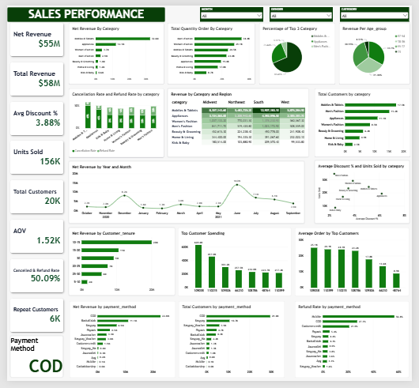

# E-Commerce Sales Performance Analysis
  

 
## Executive Summary
 
Two categories, Mobiles & Tablets and Appliances, generate 82% of valid revenue, yet they are also the categories most often cancelled. Across the business, 37% of order lines are cancelled and a further 12% are refunded, and the cancellation rate rose from 28% in October to 53% in August. Customer loyalty is low: only 31% of customers purchase a second time, while the top 10% of customers account for 70% of revenue. The recommendations focus on fixing payment and fulfilment failures, protecting the two core categories, and converting one-time buyers into repeat customers.
 
---
 
## 1. Project Overview
 
| | |
|---|---|
| **Business problem** | Understand which categories earn the most, how sales change over time, and how customers behave |
| **Period** | October 2020 to September 2021 |
| **Dataset source** | `[Dataset LInk](https://www.kaggle.com/datasets/miketaylor123/sales-data/data)` |
| **Data volume** | 286,392 raw rows `[verify]`, 204,127 after Excel cleaning, **193,794** final rows across 7 categories |
| **Tools** | Excel (cleaning, validation), Power Query (transformation), Power BI and DAX (analysis, visualisation) |
 
**Scope.** Books and School & Education were removed because of very low volume, so totals do not represent the full business. The data covers one year and contains no cost information, which means the analysis covers revenue, not profit, and year-over-year comparison is not possible.
 
> **Privacy note.** The raw data contained personal information (SSNs, emails, phone numbers). These fields are not included in this repository; only the cleaned, anonymised dataset is shared.
 
---
 
## 2. Business Questions
 
| Theme | Questions |
|---|---|
| **Products** | Which categories generate the most net revenue and units? Which have the highest cancellation and refund rates? |
| **Sales trends** | How do revenue, orders, and average order value change month by month? Which months peak, and is the cancellation rate stable? How do regions compare? |
| **Customers** | How do age, gender, and tenure affect revenue? What share of customers repeat, and how concentrated is spending? Which payment methods are used most and cancel most? How do discounts affect order size and outcome? |
 
---
 
## 3. Data Cleaning and Validation
 
| Check | Finding | Action |
|---|---|---|
| Duplicate records | 8,516 fully identical rows | Removed in Power Query |
| Inconsistent text | Mixed-case status and payment method values | Standardised |
| Revenue reconciliation | `qty_ordered × price = Total_revenue` in every row | Passed |
| Broken date field | `month` column showed 2026 for every row | Excluded; `Month Name` sorted by `Month_number` |
| Low-volume categories | Books and School & Education | Filtered out (about 1,800 rows) |
| Personal data | SSN, email, and phone in the raw sheet | Excluded from shared data |
 
**Power Query steps:** Source, Navigation, Promoted Headers, Changed Type, Removed Duplicates, Filtered Rows, Added Conditional Column, Replaced Value (twice), Changed Type.
 
**Definition of valid revenue.** All revenue KPIs use the dataset's own flag, `bi_st = "Valid"`. This flag covers statuses such as Received, Cod, Paid, Order_Refunded, and Refund, and excludes the `Net` group (Complete, Closed) and `Gross`. Because it includes refunded orders (about $26.7M of the $54.55M), cancellation and refund rates are reported separately.
 
---
 
## 4. Key DAX Measures
 
The model is a single flat table, `Cleaned_data`.
 
```DAX
Net Revenue =
CALCULATE(SUM(Cleaned_data[Net_revenue]), Cleaned_data[bi_st] = "Valid")

Total Revenue = 
CALCULATE(SUM(Cleaned_data[Total_revenue]), Cleaned_data[bi_st] = "Valid")

Units Sold =
CALCULATE(SUM(Cleaned_data[qty_ordered]), Cleaned_data[bi_st] = "Valid")
 
Valid Orders =
CALCULATE(DISTINCTCOUNT(Cleaned_data[order_id]), Cleaned_data[bi_st] = "Valid")
 
AOV = DIVIDE([Valid Net Revenue], [Valid Orders])
 
Cancellation Rate =
DIVIDE(
    CALCULATE(COUNTROWS(Cleaned_data), Cleaned_data[status] = "Canceled"),
    COUNTROWS(Cleaned_data)
)
 
Refund Rate =
DIVIDE(
    CALCULATE(COUNTROWS(Cleaned_data), Cleaned_data[status] IN {"Order_Refunded", "Refund"}),
    COUNTROWS(Cleaned_data)
)
 
Repeat Customer Rate =
DIVIDE(
    COUNTROWS(
        FILTER(
            VALUES(Cleaned_data[cust_id]),
            CALCULATE(DISTINCTCOUNT(Cleaned_data[order_id]), Cleaned_data[bi_st] = "Valid") > 1
        )
    ),
    CALCULATE(DISTINCTCOUNT(Cleaned_data[cust_id]), Cleaned_data[bi_st] = "Valid")
)
```
 
---
 
## 5. Dashboard
 
The report is a single interactive page with slicers for Month, Gender, and Category. It combines headline KPIs, category and regional breakdowns, a monthly trend, customer segmentation, and payment method analysis.
 
| KPI | Value | KPI | Value |
|---|---|---|---|
| Net Revenue (valid) | $54.55M | Total Customers | 19.8K |
| Total Revenue | $57.67M | Average Order Value | 1.52K |
| Average Discount | 3.88% | Repeat Customers | 6,102 (30.9%) |
| Units Sold | 156K | Cancellation / Refund Rate | 50.9% |
 
---
 
## 6. Key Findings
 
| Theme | Finding | Evidence |
|---|---|---|
| **Products** | Revenue depends on two categories | Mobiles & Tablets 59.8% and Appliances 22.2% of valid revenue; top 3 = 88.9% |
| | Fashion drives units, not revenue | Men's Fashion: 34.4K units (highest) but 5.3% of revenue |
| | The highest-value categories cancel most | Mobiles & Tablets 49.1%, Appliances 41.0% |
| **Trends** | Sales peaked in June | $14.0M (25.7% of valid revenue); December second at $8.2M |
| | Cancellations rose through the year | 28.5% in October to 52.8% in August |
| | Region does not explain cancellations | South leads revenue (38.1%); cancellation is 36.5–37.9% in every region |
| **Customers** | Few customers return, and spending is concentrated | 30.9% repeat rate; top 10% of customers = 70.0% of revenue |
| | Payment method strongly affects outcomes | Bankalfalah cancels 74.1%, Easypay 60.7%, COD 8.1% (COD refund rate 22.6%) |
| | Discounts lift quantity, not value | 25%+ discounts: 5.6 units per line vs 2.9 with no discount, at lower value per line |
| | Age and gender are balanced | Age bands 18–36, 37–54, 55–72 each contribute 31–33%; 51.3% female, 48.7% male |
 
---
 
## 7. Recommendations
 
| Priority | Recommendation | Rationale |
|---|---|---|
| 1 | Investigate checkout failures on digital payment methods and review COD refunds | Cancellation up to 74% on some methods |
| 2 | Audit stock accuracy and delivery times for electronics | 41–49% cancellation in the two largest categories |
| 3 | Investigate the rising cancellation rate from mid-2021 and track it monthly | 28.5% to 52.8% over the year |
| 4 | Run second-purchase offers and a loyalty programme for top customers | 30.9% repeat rate; top 10% drive 70% of revenue |
| 5 | Protect supply of Mobiles & Tablets and Appliances | 82% of valid revenue |
| 6 | Bundle fashion with electronics and reserve deep discounts for bulk or clearance | High units but low revenue; discounts lift quantity, not value |
| 7 | Plan inventory around June and December and promote in slow months | Revenue concentrated in a few months |
| 8 | Study why the Northeast and West lag the South | 17–18% revenue share each vs 38% for the South |
 
---
 
## 8. Limitations
 
The analysis covers one year, so seasonal patterns are tentative. There is no cost data, so profit and margin cannot be assessed. The `Valid` revenue flag includes refunded orders, and two categories were excluded, so totals do not represent the entire business. Relationships such as discounts and June sales are correlations and do not prove cause.

---
 
## Contact
 
**Abdulsobur Adejumo** · [LinkedIn](`www.linkedin.com/in/adejumo-abdulsobur-b40184249`)  · [Email](`adejumoabdulsobur03@gmail.com`)
 
